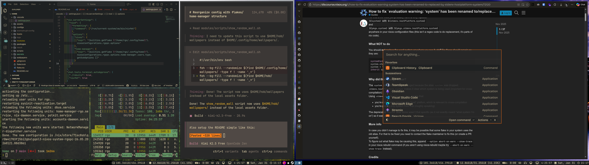

# NixOS and macOS Config



One flake-based repo that configures three of my machines:

| Host | Platform | Role |
| --- | --- | --- |
| `rgo-desktop` | NixOS (x86_64-linux) | Main desktop, Hyprland, gaming |
| `rgo-laptop` | macOS (aarch64-darwin) | nix-darwin + Home Manager + Homebrew |
| `rgo-vps` | NixOS (x86_64-linux) | Remote services and containers |

All three are on Tailscale.

## Layout

```text
flake.nix   inputs + host wiring + deploy-rs config
hosts/      per-machine top-level options
modules/    shared app, core, service, and hosting modules
packages/   local package/overlay definitions
secrets/    sops-nix encrypted files + wiring
tools/      rebuild-wizard (the `rebuild` command)
```

## Highlights

- One repo, three platforms, shared modules with per-platform gating where needed.
- Home Manager integrated into both NixOS and nix-darwin; Homebrew declaratively managed on macOS.
- `sops-nix` for personal and server secrets.
- A single `rebuild` command for every host.

## Rebuilding

```bash
rebuild             # this machine; skips activation when nothing changed
rebuild update      # update flake inputs, rebuild, refresh CLIs, skills and Homebrew in the background
rebuild vps         # deploy-rs to rgo-vps, from either machine
rebuild secrets     # edit secrets/secrets.yaml with sops (or `rebuild secrets <name>`)
```

`rebuild` refuses to run while plaintext secrets exist and never pushes.

## Secrets

Edit and re-encrypt with sops-nix:

```bash
sops secrets/secrets.yaml       # personal machines
sops secrets/vps-secrets.yaml   # rgo-vps services
sops updatekeys secrets/secrets.yaml secrets/vps-secrets.yaml  # after adding a machine
```

The personal age key lives at `~/.config/sops/age/keys.txt`; the VPS system key at `/root/.config/sops/age/keys.txt`.

## First install

Follow the flake per host. From scratch:

```bash
# macOS
nix run github:lnl7/nix-darwin/nix-darwin-26.05#darwin-rebuild -- switch --flake '.#rgo-laptop'

# NixOS desktop
sudo nixos-install --flake '.#rgo-desktop'

# VPS
nix run github:nix-community/nixos-anywhere -- \
  --flake '.#rgo-vps' --target-host root@<server-ip> \
  --build-on local --no-substitute-on-destination
```

## Troubleshooting

- `homebrew option does not exist` - you are building the wrong host. `rgo-laptop` is macOS, `rgo-desktop` is NixOS.
- `SOPS: failed to decrypt` - check `~/.config/sops/age/keys.txt` exists, matches `secrets/.sops.yaml`, and is `chmod 600`.
- macOS `_nixbld1 does not exist` after a macOS update - see `NixOS/nix#10892`.
- First build takes a long time - normal.
